<div align="center">
  
</div>

<br/>

### `~$ whoami`

```text
  .----------------.      hayrettin@ES
  | .------------. |      ------------
  | |  >_        | |      role     developer, builder of odd machines
  | |            | |      senses   deepfakes · earth from orbit · unsafe links
  | |            | |      worlds   virtual machines · games · the web
  | '------------' |      brain    big data · algorithms · edge AI
  '------.  .------'      status   online, shipping one project at a time
   .-----'  '-----.
   '--------------'       type 'scroll' for more ↓
```

### `~$ htop`

<div align="center">
  
</div>

### `~$ ls -la ~/projects`

| perms | name | what it does |
|---|---|---|
| `drwxr-xr-x` | **[synthcheck/](https://github.com/hayrettinES/synthcheck)** | Multimodal deepfake detection. 74,788 samples, 3 edge AI models, 100% offline. TÜBİTAK 2209-A. |
| `drwxr-xr-x` | **[big-data-labs/](https://github.com/hayrettinES/b-y-k-veri-payla-mlar-)** | A week-by-week log of big data labs, code included. |
| `drwxr-xr-x` | **[eduverse-chat/](https://github.com/hayrettinES/EduVerseComChat)** | Real-time web chat with C# and ASP.NET Core MVC. |
| `drwxr-xr-x` | **[link-forensics/](https://github.com/hayrettinES/linkG-venlikAnalizi)** | Java Swing tool that checks a URL *before* you click it. |
| `drwxr-xr-x` | **[there-is-escape/](https://github.com/hayrettinES/there-is-escape)** | A small escape game. One rule: get out. |
| `drwxr-xr-x` | **[algorithms/](https://github.com/hayrettinES/AVL-Agaci)** | [AVL](https://github.com/hayrettinES/AVL-Agaci) · [BFS](https://github.com/hayrettinES/BFS-graph-yapisi) · [DFS](https://github.com/hayrettinES/DFs-graph-yapisi) · [stacks](https://github.com/hayrettinES/Data-S-ralama) |
| `d---------` | `remote-sensing/` | 🔒 encrypted until release |
| `d---------` | `vbox-tool/` | 🔒 encrypted until release |
| `d---------` | `web-apps/` | 🔒 encrypted until release |

### `~$ cat ~/.stack`

```text
┌──────────────┬───────────────────────────────────────────┐
│ languages    │ C#  ·  Java  ·  Python  ·  JavaScript     │
│ web          │ ASP.NET Core MVC  ·  HTML  ·  CSS         │
│ ai           │ edge AI models  ·  offline inference      │
│ data         │ big data labs  ·  trees  ·  graphs        │
│ infra        │ VirtualBox  ·  virtual machines           │
│ play         │ game worlds  ·  escape rooms              │
└──────────────┴───────────────────────────────────────────┘
```

### `~$ tail -f /var/log/releases.log`

```text
[ queued ]  #01  ............................  to be announced
[ queued ]  #02  ............................  to be announced
[ queued ]  #03  ............................  to be announced
_
```

### `~$ ping hayrettinES`

```text
PING hayrettinES (github.com): 56 data bytes
64 bytes from hayrettinES: icmp_seq=1 ttl=64 time=0.42 ms
--- reply received, channel open ---
```

<!-- Add more channels, for example:
<a href="https://linkedin.com/in/YOUR-NAME"></a>
-->
<a href="https://github.com/hayrettinES?tab=repositories"></a>
<a href="https://github.com/hayrettinES/synthcheck/issues"></a>

<br/><br/>

<div align="center">
  
</div>
