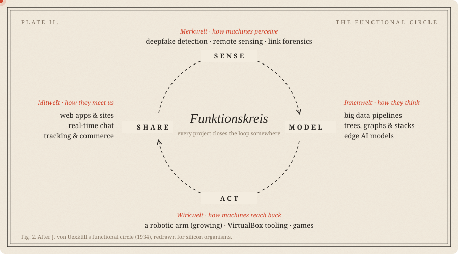
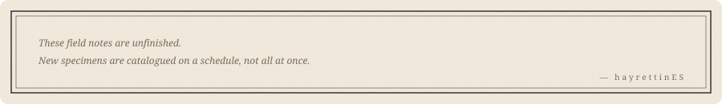

  

 

> *A tick lives in a world of exactly three signals: the smell of butyric acid, the warmth of skin, the touch of hair.
> Everything else in the universe does not exist for it.*
> — after Jakob von Uexküll, 1934
>
> **Every machine has an umwelt too.** A camera that can't tell a fake face from a real one lives in a smaller world.
> So does a satellite image nobody reads, or a robot arm that can't feel what it grabs.
> I write the software that makes those worlds bigger.

 

  

 

## 🔬 Specimen Catalogue

Sorted by which part of the loop they live in. 🟢 catalogued (public) · 🌱 being prepared for release · 🥚 still growing

#### 👁️ Merkwelt: machines that perceive

| Specimen | What it senses | |
|---|---|:---:|
| **[SynthCheck](https://github.com/hayrettinES/synthcheck)** | Whether a face or a voice is real. 74,788 samples, 3 edge AI models, fully offline. TÜBİTAK 2209-A. | 🟢 |
| **Remote Sensing** | Reading the Earth's surface from orbit. | 🌱 |
| **[Link Forensics](https://github.com/hayrettinES/linkG-venlikAnalizi)** | Whether a URL is safe *before* the click (Java Swing). | 🟢 |

#### 🧠 Innenwelt: how they think

| Specimen | What it models | |
|---|---|:---:|
| **[Big Data Lab Logs](https://github.com/hayrettinES/b-y-k-veri-payla-mlar-)** | Weekly big data labs: pipelines, code, notes. | 🟢 |
| **[AVL](https://github.com/hayrettinES/AVL-Agaci) · [BFS](https://github.com/hayrettinES/BFS-graph-yapisi) · [DFS](https://github.com/hayrettinES/DFs-graph-yapisi) · [Stacks](https://github.com/hayrettinES/Data-S-ralama)** | The skeleton under everything: trees that rebalance, graphs to explore, expressions to rewrite. | 🟢 |

#### ✋ Wirkwelt: machines that act

| Specimen | What it does to the world | |
|---|---|:---:|
| **Robotic Arm** | An in-game arm that learns to reach, grip, and place. | 🥚 |
| **VirtualBox Tooling** | A tool that builds and drives virtual machines: worlds inside worlds. | 🌱 |
| **[there-is-escape](https://github.com/hayrettinES/there-is-escape)** | A small escape game. A world with one rule: get out. | 🟢 |

#### 🤝 Mitwelt: where machines meet people

| Specimen | Who it connects | |
|---|---|:---:|
| **[EduVerse ComChat](https://github.com/hayrettinES/EduVerseComChat)** | Real-time chat, built with C# and ASP.NET Core MVC. | 🟢 |
| **Web Apps & Sites** | Tracking systems, storefronts, freelancing platforms. | 🌱 |

 

## 🗓️ Release Log

New specimens are released **one at a time, on a schedule**, each with proper documentation. They won't all be dumped here on one day.

| # | Specimen | Release window |
|:---:|---|---|
| 01 | *to be announced* | ░░░░░░░░░░ |
| 02 | *to be announced* | ░░░░░░░░░░ |
| 03 | *to be announced* | ░░░░░░░░░░ |

Watch this repo to see when the next one hatches.

 

## 🧰 Tools of the Field

 

## ✉️ Send a Signal Into My Umwelt

<!-- Add more channels, for example:

-->

  

  

